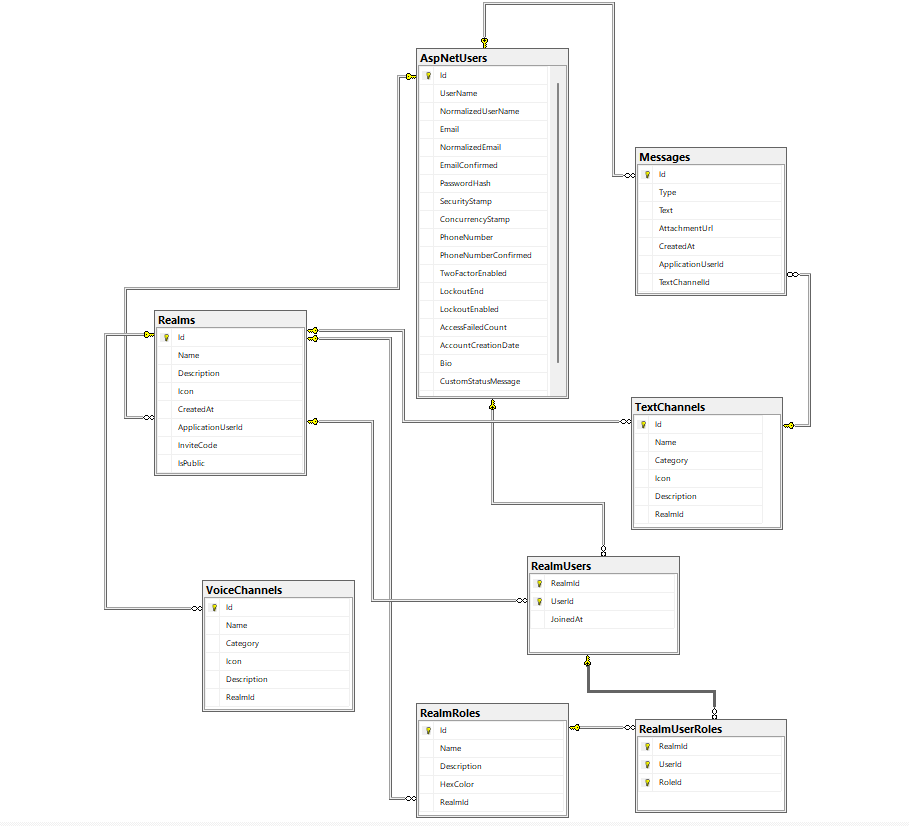

# Database Design

A realm can have many users in it, and a user can be in many realms. This many-to-many relationship is represented by RealmUser, which stores each user’s membership in a realm.

A realm also has a one-to-many relationship with roles. A realm can have many roles, but each role belongs to exactly one realm.

A member can hold many roles within a realm. I introduced RealmUserRole to represent the roles assigned to a membership. It uses the identifiers of Realm, User and Role as a composite primary key, allowing a member to have many roles while preventing the same role from being assigned to them twice.

I also configured a composite foreign key using RealmId and RoleId, which references RealmId and Id in the Role table. This ensures that a member cannot be assigned a role from another realm.
