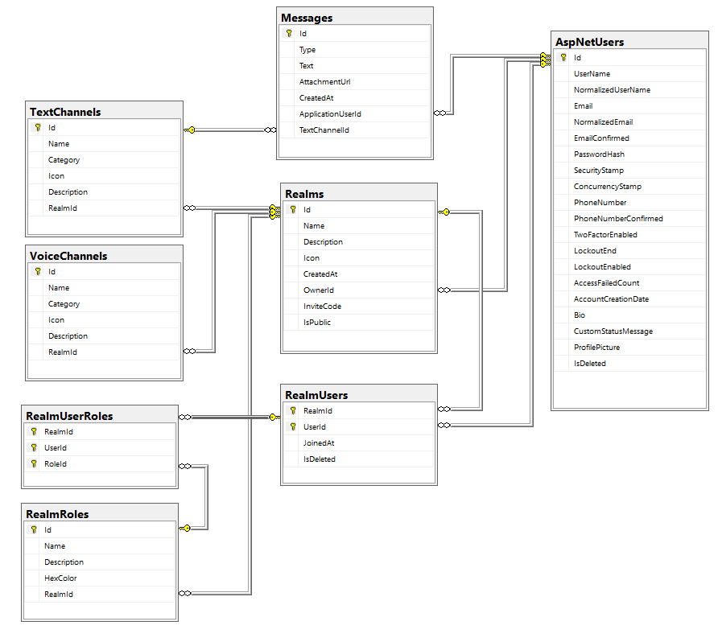

# Database Design

A realm can have many users in it, and a user can be in many realms. This many-to-many relationship is represented by RealmUser, which stores each user’s membership in a realm.

Every realm has exactly one owner, represented by the required OwnerId foreign key and the Owner navigation property. The owner is also added as a RealmUser membership when the realm is created.

The owner relationship is restricted for deletion. An owner cannot be physically removed while a realm still references them, and the account deletion workflow will require ownership to be transferred first(The future account deletion workflow will require ownership transfer first).

A realm also has a one-to-many relationship with roles. A realm can have many roles, but each role belongs to exactly one realm.

A member can hold many roles within a realm. I introduced RealmUserRole to represent the roles assigned to a membership. It uses the identifiers of Realm, User and Role as a composite primary key, allowing a member to have many roles while preventing the same role from being assigned to them twice.

I also configured a composite foreign key using RealmId and RoleId, which references RealmId and Id in the Role table. This ensures that a member cannot be assigned a role from another realm.

Both ApplicationUser and RealmUser support soft deletion.

ApplicationUser is soft-deleted so that messages and other historical records can continue referencing the original account. There is no global ApplicationUser query filter because some queries must still access deleted users. When message display is implemented, deleted authors will appear as “Deleted User.”

RealmUser is soft-deleted to preserve the membership record and its related history after a member leaves a realm.
